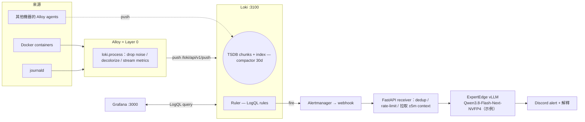

# Loki + vLLM 告警架構實戰

### 核心設計原則

**LLM 不負責偵測、不負責 suppress、不會執行任何自動修復。** 它只負責在 alert 發生後解釋證據、估計根因、提供須經人工核實才可執行的建議。即使 LLM 整個離線，告警鏈路仍照常運作——這條原則貫穿全篇。

### 前置需求

- 一台運行 Docker + Docker Compose 的 Linux host
- Discord webhook URL（用於接收通知）
- （可選）一台運行 vLLM 的機器，提供 OpenAI-compatible API
- （可選）用於跨機器收集其他 host 的日誌

---

## 第一部分：整體架構與資料流

整個系統由兩條路徑組成：



### 三條路徑的角色

- **Data path（本教學第三部分）**：容器日誌與 journald 進入 Alloy → Layer 0 在此丟棄噪音、順帶 expose stream metrics → push 到 Loki（TSDB 儲存、compactor 管理 30 日 retention）→ Grafana 以 LogQL 查詢。虛線：其他機器的 Alloy 直接推送至 Loki。
- **A 路徑（本教學第四部分）**：event-driven 即時告警。Loki ruler 的 LogQL rule 一觸發 → Alertmanager webhook → FastAPI 進行 dedup / rate-limit / 拉取前後 5 分鐘 context → 才呼叫 LLM 產生解釋 → Discord。LLM 在此是 enrichment 而非 detection。

---

## 第二部分：專案目錄結構

完整專案的最終目錄如下。教學會按順序逐一建立這些檔案：

```text
monitoring/
├── config.alloy                      # 第三部分
├── docker-compose.yml                # 第三部分（基礎）＋ 第四部分（告警服務）
├── loki-config.yaml                  # 第三部分
├── prometheus/
│   └── prometheus.yml
├── grafana/
│   ├── dashboards/
│   │   └── vllm-dashboard.json
│   └── provisioning/
│       ├── dashboards/
│       │   └── dashboards.yml
│       └── datasources/
│           ├── prometheus.yml
│           └── loki.yml              # 第四部分
├── receiver/
│   ├── alert-receiver.yml            # 可作 alertmanager.yml；見第四部分 mount 說明
│   ├── Dockerfile
│   └── main.py
├── rules/
│   └── homelab-alerts.yml            # 第三部分
├── .env                              # 不要 commit
└── README.md
```

### `.env`

```dotenv
# 切勿 commit 此檔案
DISCORD_WEBHOOK=https://discord.com/api/webhooks/<webhook-id>/<token>
```

---

## 第三部分：建立基礎日誌管道

先讓日誌「流得起、查得到」，再談告警。本部分需要四個檔案。

### 3.1 docker-compose.yml

Loki + Alloy + Grafana 一個 stack 全部啟動（已有 Grafana 可刪掉該段，只需在現有 Grafana 加入 Loki data source）。Alloy 掛載 docker.sock 收集容器日誌，掛載 `/var/log/journal` 收集 host journald，port 12345 是 Alloy UI。

```yaml
networks:
  monitoring:
    name: monitoring

services:
  loki:
    image: grafana/loki:3.7.0 # 部署前到 Docker Hub 查看最新的 patch version
    container_name: loki
    restart: unless-stopped
    command: -config.file=/etc/loki/local-config.yaml
    volumes:
      - ./loki-config.yaml:/etc/loki/local-config.yaml:ro
      - ./rules:/etc/loki/rules/fake:ro   # 注意 fake 這一層，原因見下方說明
      - loki-data:/loki                   
    ports:
      - "3100:3100"
    networks:
      - monitoring

  alloy:
    image: grafana/alloy:v1.19.2 # 同上，部署前查看 latest release
    container_name: alloy
    restart: unless-stopped
    command:
      - run
      - --server.http.listen-addr=0.0.0.0:12345
      - --storage.path=/var/lib/alloy/data
      - --disable-reporting=true
      - /etc/alloy/config.alloy
    volumes:
      - ./config.alloy:/etc/alloy/config.alloy:ro
      - alloy-data:/var/lib/alloy/data   # 存放 positions file，restart 後從上次位置繼續收集
      - /var/run/docker.sock:/var/run/docker.sock:ro
      # 以下三個 mount 只有收集 host journald 才需要
      - /var/log/journal:/var/log/journal:ro
      - /run/log/journal:/run/log/journal:ro
      - /etc/machine-id:/etc/machine-id:ro
    # 如果 journal 收不到（UI 顯示 permission denied），取消註解下面這行試試
    # user: "0:0"
    ports:
      - "12345:12345" # Alloy UI：查看 component graph、livedebugging
    depends_on:
      - loki
    networks:
      - monitoring

  # 已在運行 Grafana 就刪掉這段，只需在現有 Grafana 加入 Loki data source
  grafana:
    image: grafana/grafana:12.1.0
    container_name: grafana
    restart: unless-stopped
    ports:
      - "3000:3000"
    volumes:
      - grafana-data:/var/lib/grafana
      - ./grafana/provisioning:/etc/grafana/provisioning:ro
    networks:
      - monitoring

volumes:
  loki-data:
  alloy-data:
  grafana-data:
```

> **為什麼 rules 要 mount 到 `/etc/loki/rules/fake`？**
> 本教學的 Loki 是 `auth_enabled: false` 的單 tenant 模式，此時所有資料都歸入名為 `fake` 的預設 tenant。local ruler storage 掃描規則時是以「tenant 子目錄」為單位，因此規則檔必須出現在 `/etc/loki/rules/<tenant>/` 之下，即 `/etc/loki/rules/fake`。少這一層，ruler 會完全看不到你的規則。

### 3.2 loki-config.yaml

Loki 3.x 單節點標準寫法——TSDB + schema v13 + filesystem storage，retention 由 compactor 負責（現設定為 30 日），WAL 已開啟，防止 crash 時遺漏日誌。

```yaml
# Loki 3.x 單節點 config：TSDB + filesystem storage + compactor 做 retention
auth_enabled: false

server:
  http_listen_port: 3100
  grpc_listen_port: 9096
  log_level: info

analytics:
  reporting_enabled: false # 一併關閉 usage 上報

common:
  instance_addr: 127.0.0.1
  path_prefix: /loki
  storage:
    filesystem:
      chunks_directory: /loki/chunks
      rules_directory: /loki/rules
  replication_factor: 1
  ring:
    kvstore:
      store: inmemory

query_range:
  results_cache:
    cache:
      embedded_cache:
        enabled: true
        max_size_mb: 100

schema_config:
  configs:
    - from: 2024-01-01
      store: tsdb
      object_store: filesystem
      schema: v13
      index:
        prefix: index_
        period: 24h

storage_config:
  tsdb_shipper:
    active_index_directory: /loki/tsdb-index
    cache_location: /loki/tsdb-cache
  filesystem:
    directory: /loki/chunks

ingester:
  wal:
    enabled: true # crash 後不會遺漏最後一段日誌
    dir: /loki/wal

# Loki 3.x retention 由 compactor 負責
compactor:
  working_directory: /loki/compactor
  compaction_interval: 10m
  retention_enabled: true
  retention_delete_delay: 2h
  delete_request_store: filesystem

limits_config:
  retention_period: 720h # 30 日，想更長則調大該值
  reject_old_samples: true
  reject_old_samples_max_age: 168h
  ingestion_rate_mb: 16
  ingestion_burst_size_mb: 24
  max_streams_per_user: 10000 # 隨意新增 label 會超出此限制，所以 label 要克制
  max_line_size: 256KB
  volume_enabled: true # 讓 Grafana 用 volume histogram 查看哪個 service 日誌最多

# A 路徑的基礎：ruler 會 evaluate /etc/loki/rules 內的 LogQL alert
# 未啟動 Alertmanager 之前 ruler log 會有 connection error，不影響日誌收集
ruler:
  alertmanager_url: http://alertmanager:9093 # 第四部分會建立這個服務
  storage:
    type: local
    local:
      directory: /etc/loki/rules
  rule_path: /loki/rule-scratch
  ring:
    kvstore:
      store: inmemory
  enable_api: true
```

> **重要**：local rule storage 不支援 hot reload。每次修改 `rules/*.yml` 後都必須執行 `docker compose restart loki`。

### 3.3 config.alloy

整個收集管道：`discovery.docker` 自動發現容器（新啟動的容器會自動收集，無需重啟）→ `loki.relabel` 將容器名、compose service / project 轉為 label → `loki.process` 執行 Layer 0（拆解 Docker JSON、丟棄 healthcheck 噪音）→ `loki.write` push 到 Loki。

```hcl
// ============================================================
// Alloy pipeline：Docker logs + journald -> Loki
// UI: http://<host>:12345  可以查看 component graph 與 livedebug
// ============================================================

// ---------- 出口 ----------
loki.write "local" {
  endpoint {
    url = "http://loki:3100/loki/api/v1/push"
  }
}

// ---------- Docker 容器日誌 ----------
discovery.docker "containers" {
  host             = "unix:///var/run/docker.sock"
  refresh_interval = "15s"
}

// 將 docker meta 資料轉為低 cardinality label
// 注意：Loki label 切勿放入 container id / timestamp 這類高基數內容
loki.relabel "containers" {
  forward_to = []

  rule {
    source_labels = ["__meta_docker_container_name"]
    regex         = "/(.*)" // docker 名稱前面有個 "/"，把它去掉
    target_label  = "container"
  }

  rule {
    source_labels = ["__meta_docker_container_label_com_docker_compose_service"]
    target_label  = "service"
  }

  rule {
    source_labels = ["__meta_docker_container_label_com_docker_compose_project"]
    target_label  = "project"
  }
}

loki.source.docker "containers" {
  host          = "unix:///var/run/docker.sock"
  targets       = discovery.docker.containers.targets
  labels        = { job = "docker", host = "docker-01" } // host 改為你的主機名稱
  relabel_rules = loki.relabel.containers.rules
  forward_to    = [loki.process.containers.receiver]
}

// Layer 0 在這裡：幾乎零成本的過濾 + 順帶輸出 baseline metrics
loki.process "containers" {
  forward_to = [loki.write.local.receiver]

  // 拆解 Docker JSON 格式（log / stream / time）
  stage.docker {}

  // 去除 ANSI 色碼，之後 regex 容易撰寫得多
  stage.decolorize {}

  // Drop 已知噪音：healthcheck 頻繁請求是最常見的
  stage.drop {
    expression          = ".*(GET /health|GET /api/health|healthcheck|GET /ping).*"
    drop_counter_reason = "healthcheck_noise"
  }

  // 有規律的 debug spam 也可以在此 drop，例如：
  // stage.drop {
  //   source              = "service"
  //   value               = "some-chatty-app"
  //   expression          = ".*DEBUG.*"
  //   drop_counter_reason = "debug_spam"
  // }

  // 順帶統計每個 stream 的行數/bytes，expose 在 :12345/metrics
  stage.metrics {
    metric.counter {
      name              = "stream_lines_total"
      description       = "log lines per stream"
      match_all         = true
      action            = "inc"
      max_idle_duration = "24h"
    }
    metric.counter {
      name              = "stream_bytes_total"
      description       = "log bytes per stream"
      match_all         = true
      count_entry_bytes = true
      action            = "add"
      max_idle_duration = "24h"
    }
  }
}

// ---------- Host systemd journal（可選，不需要可以整段刪除） ----------
loki.relabel "journal" {
  forward_to = []

  rule {
    source_labels = ["__journal__systemd_unit"]
    target_label  = "unit"
  }

  rule {
    source_labels = ["__journal_priority_keyword"]
    target_label  = "level"
  }
}

loki.source.journal "host" {
  forward_to    = [loki.write.local.receiver]
  relabel_rules = loki.relabel.journal.rules
  labels        = { job = "journal", host = "docker-01" } // 同上，改回主機名稱
  max_age       = "1h" // 第一次啟動只補收最近一小時，不要一次灌入所有歷史日誌
}
```

### 3.4 起手告警規則 rules/homelab-alerts.yml

三條 LogQL alert 起手式（error 爆升、SSH 爆破、OOM kill）。ruler 已在 config 中預先配置；未接 Alertmanager 之前，可以先在 Grafana Alerting 頁面直接查看 firing 狀態。

```yaml
# 放在 ./rules/ 內，Loki ruler 會自動載入
groups:
  - name: homelab-logs
    interval: 1m
    rules:
      # 單一容器 5 分鐘內 error 數量急升
      - alert: ContainerErrorBurst
        expr: sum by (container) (count_over_time({job="docker"} |~ "(?i)(error|fatal|panic)" [5m])) > 10
        for: 0m
        labels:
          severity: warning
        annotations:
          summary: "Container {{ $labels.container }} 5 分鐘內出現 {{ $value }} 條 error"

      # SSH 爆破嘗試
      - alert: SSHBruteForce
        expr: count_over_time({job="journal"} |~ "Failed password" [5m]) > 10
        for: 0m
        labels:
          severity: critical
        annotations:
          summary: "5 分鐘內 {{ $value }} 次 SSH failed password"

      # Kernel OOM killer 出動
      - alert: OOMKill
        expr: count_over_time({job="journal"} |~ "(?i)(oom-kill|out of memory)" [5m]) > 0
        for: 0m
        labels:
          severity: critical
        annotations:
          summary: "Host 有 process 被 OOM killer 終止"
```

### 3.5 啟動與初步驗證

```bash
docker compose up -d
docker compose ps
curl -s http://localhost:3100/ready
curl -s http://localhost:3100/loki/api/v1/rules
```

最後一條命令的回應應包含 `homelab-logs` rule group，代表規則已載入。接著到 Grafana Explore 以 LogQL 查詢 `{job="docker"}`，能見到容器日誌即代表基礎管道完成。可用 Explore 的 **Label browser** 快速組合 selector（選 `job` label → 選 `docker` value → 產生 `{job="docker"}`）：


查詢結果（Show logs）應見到 Logs volume histogram 同日誌行，即代表管道打通：


---

## 第三部分之二：在其他 Host 安裝 Alloy Agent

當你需要從多台主機收集日誌時，最輕量的方式是每台機器跑一個 **Alloy agent container**，以 push 模式將日誌直接傳回中央 Loki。這不需要在 remote host 安裝完整的 Loki 或 Grafana，也不需要 SSH 登入拉取日誌。

### 3.5.1 架構概述

```
┌─────────────────────┐         LAN                    ┌──────────────────┐
│  Remote Host #1     │ ── push (Alloy agent) ──────── │                  │
│  - journald         │        HTTPS (或 plain HTTP)   │  Central Host    │
│  - Docker logs      │                                │  - Loki :3100    │
│                     │                                │  - Grafana       │
│  Host name: app-01  │                                │                  │
└─────────────────────┘                                └──────────────────┘

┌─────────────────────┐          LAN                   ┌──────────────────┐
│  Remote Host #2     │ ── push (Alloy agent) ──────── │                  │
│  - journald         │        HTTPS (或 plain HTTP)   │  Central Loki    │
│                     │                                │  (single source  │
│  Host name: db-01   │                                │   of truth)      │
└─────────────────────┘                                └──────────────────┘
```

每台 remote host 只需要一個 Alloy container，負責：
1. 收集本機的 journald（以及可選的 Docker 容器日誌）
2. 執行 Layer 0 過濾
3. Push 到中央 Loki 的 `/loki/api/v1/push`

所有機器共用同一份 LogQL 規則（存放在中央 Loki），並透過 `host` label 區分來源。

### 3.5.2 Remote Host docker-compose.yml

放在 remote host 的任意目錄（例如 `~/alloy-agent/docker-compose.yml`）：

```yaml
services:
  alloy:
    image: grafana/alloy:v1.19.2
    container_name: alloy-agent
    restart: unless-stopped
    volumes:
      - ./config.alloy:/etc/alloy/config.alloy:ro
      - alloy-data:/var/lib/alloy/data
      # journald collection 需要
      - /var/log/journal:/var/log/journal:ro
      - /run/log/journal:/run/log/journal:ro
      - /etc/machine-id:/etc/machine-id:ro
      # 如果也跑 Docker 要加上
      # - /var/run/docker.sock:/var/run/docker.sock:ro
    # 如果 journal 收不到（UI 顯示 permission denied），取消註解
    # user: "0:0"
    # 如果 remote host 不需要 Alloy UI，註解掉 ports 即可
    ports:
      - "12345:12345"
    networks:
      - default

volumes:
  alloy-data:
```

> 如果 remote host 也跑 Docker 容器，取消註解 `docker.sock` mount 和 `discovery.docker` 段（見下方 config.alloy）。如果不需要 Alloy UI（通常不需要），可以移除 `ports` 段。

### 3.5.3 Remote Host config.alloy

每個 remote host 的 config 都相同（除了 `host` label），建議用 Git 或配置管理工具同步：

```hcl
// ============================================================
// Alloy agent pipeline：journald (→ Docker) -> Central Loki
// 這是 push 模式，不需要反向代理或 sidecar
// ============================================================

// ---------- 出口：指向中央 Loki ----------
// 如果 Loki 在 上：
loki.write "central" {
  endpoint {
    url = "http://<Loki-host>:3100/loki/api/v1/push" // 改為 Loki host 的  IP
  }
}

// ---------- 如果該 host 也跑 Docker ----------
// discovery.docker "containers" {
//   host             = "unix:///var/run/docker.sock"
//   refresh_interval = "15s"
// }
//
// loki.relabel "containers" {
//   forward_to = []
//
//   rule {
//     source_labels = ["__meta_docker_container_name"]
//     regex         = "/(.*)"
//     target_label  = "container"
//   }
//
//   rule {
//     source_labels = ["__meta_docker_container_label_com_docker_compose_service"]
//     target_label  = "service"
//   }
// }
//
// loki.source.docker "containers" {
//   host          = "unix:///var/run/docker.sock"
//   targets       = discovery.docker.containers.targets
//   labels        = { job = "docker", host = "app-01" } // <--- 每台機器改不同
//   relabel_rules = loki.relabel.containers.rules
//   forward_to    = [loki.process.containers.receiver]
// }
//
// loki.process "containers" {
//   forward_to = [loki.write.central.receiver]
//
//   stage.docker {}
//   stage.decolorize {}
//
//   stage.drop {
//     expression          = ".*(GET /health|GET /api/health|healthcheck|GET /ping).*"
//     drop_counter_reason = "healthcheck_noise"
//   }
// }

// ---------- Host systemd journal ----------
loki.relabel "journal" {
  forward_to = []

  rule {
    source_labels = ["__journal__systemd_unit"]
    target_label  = "unit"
  }

  rule {
    source_labels = ["__journal_priority_keyword"]
    target_label  = "level"
  }
}

loki.source.journal "host" {
  forward_to    = [loki.write.central.receiver]
  relabel_rules = loki.relabel.journal.rules
  // <--- 每台機器換成自己的名稱，這會成為 Grafana 裡過濾的 key
  labels        = { job = "journal", host = "app-01" }
  max_age       = "1h"
}
```

**每個 remote host 只需要改一行：** `labels = { ..., host = "app-01" }`。建議用機器的主機名稱或有意義的代號（如 `db-01`、`app-02`、`proxy-01`）。

### 3.5.4 連線設定

如果 Loki host 和 remote host 之間連線：

1. 確認兩台機器都加入了同一個
2. 獲取 Loki host 的IP：
   ```bash
   # 在 remote host 上執行
   curl -s ifconfig.me
   ```
3. 將該 IP 填入 config.alloy 的 `url = "http://<loki-host>:3100/loki/api/v1/push"`

如果希望更安全，可以：
- 啟用 Loki 的 TLS + basic auth（見下方進階設定）

### 3.5.5（可選）Loki 端 Basic Auth 保護

如果你的 Loki 暴露在無法完全信任的網路，可以加上 basic auth：

在 `loki-config.yaml` 的 `limits_config` 之前加入：

```yaml
# 啟用 basic auth
auth_enabled: true

server:
  http_listen_port: 3100
  grpc_listen_port: 9096
  log_level: info

```

然後在 remote config.alloy 使用 OAuth2 或 HTTP header 帶 credentials：

```hcl
loki.write "central" {
  endpoint {
    url = "http://<loki-host>:3100/loki/api/v1/push"
    // 注意：basic auth 建議用 reverse proxy + TLS，
    // 或考慮用 OAuth2（Grafana Align 內建支援）
    tenant_id = "remote-host-1"
  }
}
```


### 3.5.6 在 Remote Host 啟動

```bash
# 在每台 remote host 上
cd ~/alloy-agent
docker compose up -d

# 確認啟動
docker compose ps
docker logs alloy-agent --tail 20
```

然後在 Central Loki 驗證：

```bash
# 查看所有收到的 host label
curl -s 'http://localhost:3100/loki/api/v1/labels' | jq '.[] | select(startswith("host"))'

# 查詢特定 host 的日誌
curl -s 'http://localhost:3100/loki/api/v1/query?query={host="app-01"}' | jq '.data.result[] | .stream'
```

### 3.5.7 在 Rule 中過濾特定 Host

告警規則現在可以精準針對單一機器：

```yaml
groups:
  - name: homelab-logs
    interval: 1m
    rules:
      # 只檢查 app-01 的 error
      - alert: App01ErrorBurst
        expr: sum by (container) (count_over_time({job="journal", host="app-01"} |~ "(?i)(error|fatal|panic)" [5m])) > 10
        for: 0m
        labels:
          severity: warning
        annotations:
          summary: "app-01 上 Container {{ $labels.container }} 5 分鐘內出現 {{ $value }} 條 error"

      # 全網 OOM — 不指定 host，所以任何機器觸發都會 alert
      - alert: OOMKill
        expr: count_over_time({job="journal"} |~ "(?i)(oom-kill|out of memory)" [5m]) > 0
        for: 0m
        labels:
          severity: critical
        annotations:
          summary: "Host {{ $labels.host }} 有 process 被 OOM killer 終止"
```

### 3.5.8 擴展建議

| 需求 | 做法 |
| --- | --- |
| 2–5 台 remote host | 每個 host 一個 Alloy container，同一個 compose 模板 |
| 10+ remote host | 考慮 Ansible / Terraform 自動部署 config.alloy |
| 需要集中管理 config | 用 GitOps：remote host 拉取同一份 config repo |
| 需要 TLS | 在 Loki 前面放 Nginx reverse proxy + Let's Encrypt |
| 需要更高吞吐 | 評估 Loki 分片或多 tenant 模式 |

---

## 第四部分：接入 A 路徑告警鏈路

基礎管道完成後，把「firing alert」接到「Discord 通知 + LLM 分析」。鏈路如下：

```text
Alloy → Loki → Loki Ruler → Alertmanager → alert-receiver
      → Loki query_range（提取 context）→ vLLM → Discord
```

各環節職責：

- **Detection**：由 Loki ruler 以 LogQL 計數 / threshold 執行；即使 LLM 故障，alert 仍會照常運作。
- **Enrichment**：receiver 收到 alert 後，按低 cardinality labels 向 Loki 提取近 10 分鐘的 log context。
- **Triage**：LLM 輸出【懷疑根因】【證據】【建議行動】；僅屬 advisory，不會 restart container 或修改設定。
- **Notification**：Discord webhook。Discord HTTP `204 No Content` 代表成功送達。

### 4.1 Grafana Loki datasource provisioning

建立 `grafana/provisioning/datasources/loki.yml`：

```yaml
apiVersion: 1

datasources:
  - name: Loki
    type: loki
    access: proxy
    url: http://loki:3100
    jsonData:
      manageAlerts: true
```

Grafana compose 必須 mount provisioning directory（第三部分已加入），然後執行：

```bash
docker compose restart grafana
```

Grafana 的 **Alerting → Alert rules** 會顯示由 Loki ruler 管理的 rules。使用 local storage 時，建議 rules 繼續以檔案化 / Git 方式管理，不要依賴 UI 修改。

### 4.2 Alertmanager

`alertmanager.yml`（可放於根目錄；如保留在 `receiver/alert-receiver.yml`，compose mount path 亦須跟著修改）：

```yaml
route:
  receiver: alert-receiver
  group_by: [alertname, container, severity]
  group_wait: 30s
  group_interval: 5m
  repeat_interval: 4h

receivers:
  - name: alert-receiver
    webhook_configs:
      - url: http://alert-receiver:8000/alerts
        send_resolved: true
```

在 compose 加入 Alertmanager 服務：

```yaml
  alertmanager:
    image: prom/alertmanager:v0.28.1
    container_name: alertmanager
    restart: unless-stopped
    volumes:
      - ./alertmanager.yml:/etc/alertmanager/alertmanager.yml:ro
      - am-data:/alertmanager
    networks:
      - monitoring
```

如果檔案實際位於 `receiver/alert-receiver.yml`：

```yaml
      - ./receiver/alert-receiver.yml:/etc/alertmanager/alertmanager.yml:ro
```

### 4.3 alert-receiver

Receiver、Loki、Alertmanager 必須位於同一個 Docker `monitoring` network，因為它們使用 service name（`loki`、`alertmanager`、`alert-receiver`）進行 DNS resolution。

```yaml
  alert-receiver:
    build: ./receiver
    container_name: alert-receiver
    restart: unless-stopped
    environment:
      DISCORD_WEBHOOK: ${DISCORD_WEBHOOK}
      LOKI_URL: http://loki:3100
      LLM_URL: http://<vLLM-endpoint>:8000/v1   # 改為你的 vLLM endpoint
      LLM_MODEL: <vLLM /v1/models 回傳的 data[].id>
      LLM_ENABLED: "true"
      CONTEXT_WINDOW_MIN: "5"
      DEDUP_TTL_SEC: "3600"
      MAX_LLM_CONCURRENCY: "2"
    depends_on:
      - loki
    networks:
      - monitoring
```

確認實際 model ID：

```bash
curl -s http://<vLLM-endpoint>:8000/v1/models | jq -r '.data[].id'
```

確認 receiver 確實讀取到 environment：

```bash
docker exec alert-receiver printenv LLM_ENABLED LLM_URL LLM_MODEL
```

> 修改 compose environment 後須以 `docker compose up -d` 重建 container；單獨使用 `docker compose restart` **不會**重新讀取 `.env` / compose environment。

### 4.4 Receiver 行為細節

`receiver/main.py` 的重要行為，實作時請留意：

1. `POST /alerts` 接收 Alertmanager 的 JSON payload，並立即回傳 `200 OK`；耗時工作（Loki query、LLM）改在 background task 執行，避免 Alertmanager timeout。
2. 以 alert fingerprint 進行 in-memory dedup，預設同一 fingerprint 1 小時內只通知一次。
3. 只使用 `job, host, container, service, unit, level` 組成 Loki selector，避免不受控的 label 注入 LogQL。
4. 使用 `time.time_ns()` 產生 query timestamps，避免 Python float 轉為科學記數法導致 Loki `/query_range` 回傳 `400`。
5. thinking-capable 模型回覆時，`message.content` 可能是 `null`；程式會 fallback 到 `message.reasoning_content`，並在內容為空時 fallback 為 plain alert。
6. 當 LLM API 失敗、timeout 或 model name 錯誤時，receiver 仍會照常推送 plain Discord alert；監控不依賴 LLM。

目前 prompt 應明確指出：alert 是由 **Loki log count rules** 產生，而非 Prometheus metrics alert。建議在 system prompt 保留：

```text
Alert 全部來自 Loki ruler 的 log count rule（而非 metrics system）。
```

### 4.5 最速手動驗證

略過 ruler / Alertmanager，直接驗證 receiver → Loki → vLLM → Discord 全鏈路：

```bash
curl -X POST http://<monitoring-host>:8000/alerts \
  -H 'Content-Type: application/json' \
  -d '{"alerts":[{"status":"firing","labels":{"alertname":"ManualTest","severity":"warning","job":"docker","container":"vllm-grafana"},"annotations":{"summary":"手動測試：receiver 鏈路檢查"},"fingerprint":"manual-test-'$(date +%s)'"}]}'
```

預期：Discord 出現 alert embed，`LLM_ENABLED=true` 時帶 `🤖 LLM triage` field。注意同一 fingerprint 會被 dedup 1 小時，所以 `date +%s` 確保每次不同。

成功效果如下圖（LLM 正確識別出手動測試 alert、Grafana 正常 302 redirect，建議直接 dismiss）：


